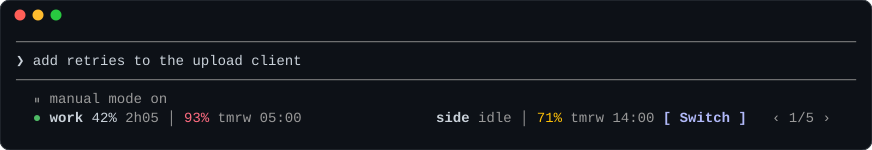
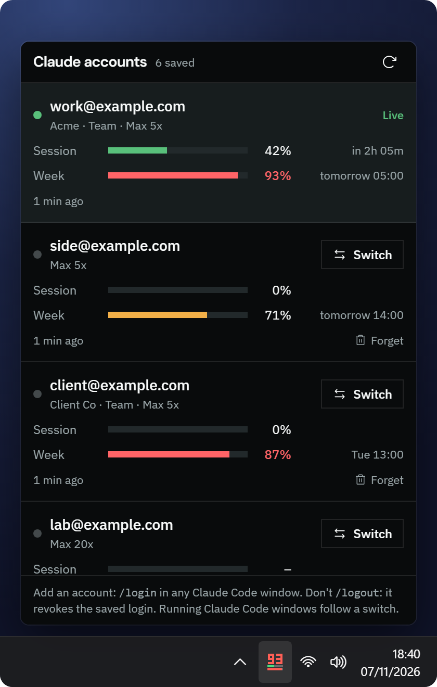
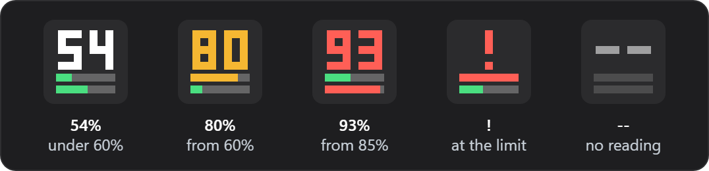

<h1 align="center">Claude Subs</h1>

<p align="center">
  Switch Claude Code between your Claude accounts in one click,<br>
  and see how much of each account's 5-hour and weekly limit is left.
</p>

<p align="center">
  <a href="https://github.com/Duoquote/claude-subs/releases/latest"></a>
  
</p>

<p align="center">
  
</p>

- **In Claude Code:** a band under the prompt. Your live account is on the left, and the best
  account to switch to is on the right. Click **Switch**, and every running session carries on
  with that account.
- **On Windows:** a [tray icon](#windows-tray) with the live account's usage, and a popover of all
  your accounts.
- **Anywhere:** `claude-subs status`, `claude-subs switch <account>`.

## Install

**Linux and macOS** (x86_64, arm64):

```sh
curl -fsSL https://raw.githubusercontent.com/Duoquote/claude-subs/main/install.sh | sh
```

Run it again to update. `... | sh -s -- --uninstall` removes it; your saved logins stay in
`~/.local/share/claude-subs` until you delete that folder.

On macOS, Claude Code keeps its login in the login keychain, and claude-subs reads and writes it
there the way Claude Code does. macOS keeps that keychain closed to SSH sessions, so use Claude Code
and claude-subs from a terminal on the Mac itself.

**Windows:** [build it](#build), start `target\release\claude-subs.exe`, then load the mod:

```powershell
target\release\claude-subs.exe setup --mod-dir "$PWD\mod"
```

## Use

1. **Add accounts:** run `/login` in Claude Code, once per account. Each login is saved by itself.
2. **Switch:** click **Switch** in the band (Claude Code's fullscreen mode, `"tui": "fullscreen"`),
   type `/subs <account>`, or run `claude-subs switch <account>`. Running sessions pick up the new
   account with their next request.
3. **Never `/logout`:** it revokes the login at Anthropic, and the saved copy goes with it. The mod
   asks before letting one through.

An account marked **needs /login** has a login that expired (after about 30 days unused) or was
revoked: run `/login` with it again.

### Reading the band

Each account reads `name session │ week`, like `work 42% 2h05 │ 93% tmrw 05:00`.

| Shows | Means |
|---|---|
| `42% 2h05` | 42% used, resets in 2 h 05 min |
| `93% tmrw 05:00` | resets tomorrow at 05:00; further out `Sat 11:00`, then `14 Nov` |
| `idle` | not started yet: the window starts with the account's first message |
| `∞` | the plan has no 5-hour limit |
| `full 40m` | at the limit, free again in 40 min |

Amber from 60%, red from 85%. In a narrow terminal the reset times go first.

### Which account it offers

Weekly room that resets unused is lost, so the band offers the account whose **week resets
soonest** and that has at least **10% room** left (of its week, and of its session while one is
running):

```text
score = 100 × (1 − hours until the week resets ÷ 168)
      + up to 20 for a running session with room left that resets soon
```

`‹ ›` pages through the rest, best first (`1/5` is the best), and the band returns to the best
30 seconds later. **Switch** is highlighted when that account is a better pick than the live one:
in the picture, `work` is at 93% of its week, so `side` is the one to use.

## Windows tray

<p align="center">
  
</p>

Click the icon for every account, with its meters and a **Switch** button. Hover for the reset
times; right-click to switch, refresh, or start at login. Times follow your 12/24-hour setting.

The icon shows the live account's fuller limit as a number, over two bars: the session on top,
the week below.

<p align="center">
  
</p>

## Commands

| In Claude Code | Does |
|---|---|
| `/subs` | list the accounts |
| `/subs <account>` | switch, by email, name or number |
| `/subs refresh` | read every account's usage now |
| `/subs hide` · `/subs show` | hide or show the band |
| `/subs above` · `/subs below` | put the band over the prompt or back under it |

```console
$ claude-subs status
* 1  work@example.com    session  42% (in 2h 05m)  week  93% (tomorrow 05:00)  live
  2  side@example.com    session   0%  week  71% (tomorrow 14:00)
  3  client@example.com  session   0%  week  87% (Tue 13:00)
  4  lab@example.com     session   -  week  40% (Tue 20:00)
```

```text
claude-subs status [--json]     the accounts and their usage
claude-subs switch <account>    make it the live login
claude-subs refresh             read every account's usage now
claude-subs forget <account>    remove a saved account (not the live one)
claude-subs setup [--remove]    load (or unload) the Claude Code mod
```

<details>
<summary><b>How it works</b></summary>

<br>

Claude Code keeps its login in two places: the tokens in `~/.claude/.credentials.json`
(`claudeAiOauth`; on macOS, the keychain item `Claude Code-credentials`) and the account in
`~/.claude.json` (`oauthAccount`). Every Claude Code process re-reads the credentials before its
requests (on macOS, at most 30 seconds later) and adopts what changed. That is how a `/login` in
one session reaches the others, and how a switch does. Each token refresh replaces the refresh
token, so a login must live in exactly one place at a time. Claude Subs keeps to that:

- **Capture:** when the credentials change (a refresh by Claude Code, or a `/login`), Claude Subs
  asks whose tokens they are and saves them under that account. The tray app watches the file. On
  Linux and macOS the mod runs `claude-subs tick` when the file changes or the readings are 90
  seconds old, and `claude-subs sync` before a `/login`.
- **Switch:** take Claude Code's refresh locks (`~/.claude/.oauth_refresh.lock`, `~/.claude.lock`),
  save the outgoing tokens, back up `~/.claude.json`, write the incoming account into it (every
  other key kept), atomically replace `claudeAiOauth` (MCP logins kept), release the locks.
- **Usage:** for the live account, Claude Code's own cached reading when it is newer, else
  `GET /api/oauth/usage` at most every 5 minutes; Claude Subs never refreshes the live tokens. The
  other accounts are read every 15 minutes, refreshing their tokens when needed, which also keeps
  their 30-day logins alive. On HTTP 429 it backs off, up to an hour.
- **Several processes:** the tray app and each command change the vault only under `vault.lock`,
  re-reading it first if another saved in the meantime. Each writes `status.json` (no tokens),
  which the mod reads.

The usage, profile and token endpoints are the ones Claude Code calls. They are not a documented
API and may change. The mod uses Claude Code's function hooks, an early-access feature; if a
release breaks the mod, the command line keeps working.

</details>

<details>
<summary><b>Files</b></summary>

<br>

The data folder is `%LOCALAPPDATA%\claude-subs` on Windows and `~/.local/share/claude-subs` on
Linux and macOS (`$XDG_DATA_HOME`), or `CLAUDE_SUBS_DATA_DIR`. `CLAUDE_CONFIG_DIR` is honoured as Claude
Code honours it.

| File | Holds |
|---|---|
| `vault.dat` | the saved logins. Windows: sealed with DPAPI for your user on this machine. Linux and macOS: a file only your user can read (0600) |
| `status.json` | accounts and usage, no tokens: what the mod reads |
| `settings.json` | `poll_active_secs` (300), `poll_idle_secs` (900), `refresh_idle` (true) |
| `backups/` | `~/.claude.json` before each switch (the last 10), `~/.claude/settings.json` before `setup` |
| `logs/` | daily logs, never with tokens; `CLAUDE_SUBS_LOG=debug` for more |

</details>

## Build

```sh
cargo test                                  # the switch runs in a sandbox, no network
cargo build --release                       # the command line (Linux, macOS)
cd ui && bun install && bun run build && cd .. && cargo build --release   # Windows, with the tray app
claude plugin test mod                      # the mod's tests
```

Pushing a `v*` tag builds the Linux and macOS releases (`.github/workflows/release.yml`).
